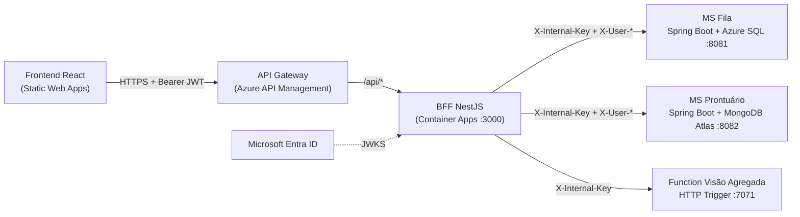
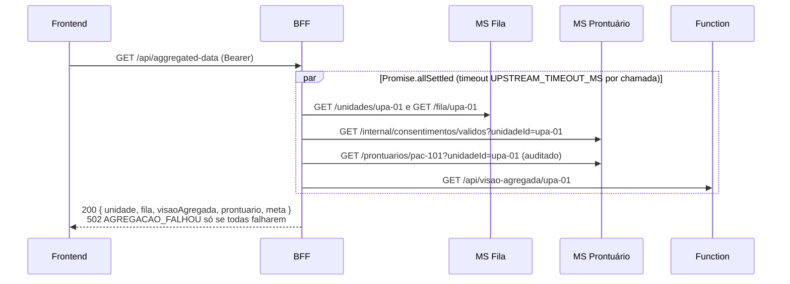

# Open Prontuário — BFF (Backend for Frontend)

BFF em **Node.js + NestJS** do projeto PJBL **Open Prontuário** (filas de UBS/UPA com prontuário
compartilhado por consentimento). É o **único ponto de entrada do frontend** (atrás do API Gateway) e
é responsável por:

- **Autenticação** — valida o JWT (Microsoft Entra ID ou modo dev HS256) e extrai `oid`, `name`, `roles`;
- **Autorização por perfil** — `PACIENTE`, `ATENDENTE`, `PROFISSIONAL`, `GESTOR` (extensão `x-roles` do contrato);
- **Proxy CRUD** — repassa as operações aos microserviços com `X-Internal-Key`, `X-User-Id`,
  `X-User-Roles`, `X-User-Name` e `X-Correlation-Id`; erros dos serviços voltam com o mesmo status e corpo;
- **Orquestração** — aviso de chegada + consentimento, fila + `prontuarioAutorizado`, unidades próximas + indicadores;
- **Agregação** — `GET /api/aggregated-data` (endpoint obrigatório do PJBL), um único JSON com MS Fila (SQL),
  MS Prontuário (Mongo) e a Function, com **degradação graciosa**.

## Arquitetura



Fluxo do `GET /api/aggregated-data?unidadeId=upa-01&pacienteId=pac-101`:



### Clean Architecture + Vertical Slice

```
src/
├── domain/                     # TS puro: tipos e regras (sem Nest, sem fetch, sem jose)
│   ├── usuario.ts              #   Perfil, Usuario, PERSONAS do seed (CONVENCOES §8)
│   ├── agregacao.ts            #   montarDadosAgregados: degraded / falhas / avisos / AGREGACAO_FALHOU
│   ├── fila.ts                 #   marcarProntuarioAutorizado
│   ├── unidade.ts              #   mesclarVisoes (unidades próximas × visão agregada)
│   └── erros.ts                #   ErroNegocio + códigos da CONVENCOES §4
├── application/                # casos de uso (classes puras, um método `executar`) por fatia
│   ├── ports/                  #   MsFilaPort, MsProntuarioPort, VisaoAgregadaPort, UpstreamPort,
│   │                           #   TokenVerifierPort, TokenIssuerPort, Contexto, ErroUpstream
│   ├── aggregated-data/obter-dados-agregados/
│   ├── fila/avisar-chegada/    #   MS Fila + consentimento no MS Prontuário
│   ├── fila/listar-fila/       #   MS Fila + /internal/consentimentos/validos
│   ├── unidades/listar-proximas/  # MS Fila + Function em lote
│   ├── auth/emitir-dev-token/  auth/listar-personas/
│   └── proxy/encaminhar-requisicao/  # pass-through (bloqueia /internal e "..")
├── infrastructure/             # adapters de saída
│   ├── http/                   #   HttpUpstreamClient (fetch + AbortSignal.timeout) e adapters tipados
│   └── auth/jwt.ts             #   DevJwt (HS256) e EntraJwtVerifier (RS256 via JWKS)
├── api/                        # adapters de entrada: um controller por feature
│   ├── auth/                   #   AuthController, JwtAuthGuard, RolesGuard, @Perfis/@Publico
│   ├── comum/                  #   X-Correlation-Id, filtro problem+json, helper de proxy
│   ├── aggregated-data/ unidades/ lotacoes/ fila/ prontuarios/ consentimentos/ auditoria/ health/
└── bootstrap/                  # composition root: AppModule.forRoot(config), main.ts, config
```

Regras (verificadas por `dependency-cruiser` em `npm test`, arquivo `.dependency-cruiser.cjs`):
`api → application → domain`; `infrastructure → application → domain`; `api` e `infrastructure`
não se importam; só `bootstrap` conhece todas as camadas; `domain`/`application` não importam
`@nestjs/*`, `jose`, Express nem módulos de I/O; um caso de uso não importa outro; sem ciclos nem órfãos.

**Prova de que o teste de arquitetura falha:** foi adicionada temporariamente a linha
`import '../../infrastructure/auth/jwt';` em `src/api/health/health.controller.ts` (e, em outra rodada,
`import '@nestjs/common'` em `src/domain/fila.ts` e `import 'node:fs'` num caso de uso). O
`npm test` ficou vermelho com
`error api-nao-conhece-infrastructure: src/api/health/health.controller.ts → src/infrastructure/auth/jwt.ts`
(e `domain-sem-framework-nem-io`, `application-sem-framework-nem-io`, `fatias-de-application-isoladas`,
`sem-ciclos` nas demais). As violações foram revertidas e não foram commitadas.

## Tecnologias

NestJS 11 · TypeScript 5 (`strict`) · Node.js 24 (≥ 22) · `@nestjs/swagger` · `class-validator` ·
`jose` (JWT/JWKS) · `fetch` nativo · Jest 30 + ts-jest + supertest · dependency-cruiser · ESLint 9
(typescript-eslint) · Docker (node:24-alpine).

## Endpoints

Swagger UI: **`/api/docs`** · OpenAPI JSON: **`/api/docs-json`** · contrato: [`contract/bff.openapi.yaml`](contract/bff.openapi.yaml)
(cópia de `open-prontuario-platform/docs/contracts/bff.openapi.yaml`).

| Rota (prefixo `/api`) | Perfis | Destino |
|---|---|---|
| `GET /health` | público | BFF |
| `GET /auth/personas`, `POST /auth/dev-token` | público, só `AUTH_MODE=dev` (404 em `entra`) | BFF |
| `GET /auth/me` | todos | BFF |
| `GET /aggregated-data?unidadeId=&pacienteId=` | ATENDENTE, PROFISSIONAL, GESTOR | MS Fila + MS Prontuário + Function |
| `GET /unidades/proximas` | PACIENTE | MS Fila + Function (indicadores `null` se a Function cair) |
| `GET /fila/{unidadeId}` | ATENDENTE, PROFISSIONAL, GESTOR | MS Fila + MS Prontuário (`prontuarioAutorizado`) |
| `POST /fila/{unidadeId}/aviso-chegada` | PACIENTE | MS Fila + MS Prontuário (consentimento) |
| `GET/POST /unidades`, `GET /unidades/minhas`, `GET/PUT/DELETE /unidades/{id}` | conforme `x-roles` | MS Fila |
| `GET /unidades/{id}/visao-agregada` | todos | Function |
| `GET/POST /lotacoes`, `DELETE /lotacoes/{id}` | GESTOR | MS Fila |
| `DELETE /fila/{registroId}`, `POST .../confirmar-chegada`, `PATCH .../prioridade`, `POST .../iniciar-atendimento` | ATENDENTE, PROFISSIONAL | MS Fila |
| `/prontuarios/**`, `/consentimentos/**`, `GET /auditoria/prontuarios/{id}` | conforme `x-roles` | MS Prontuário |

Rotas `/internal/**` dos serviços **nunca** são expostas. Erros seguem RFC 9457 (`application/problem+json`)
com `codigo` e `correlationId`; timeout/conexão recusada → `503 DEPENDENCIA_INDISPONIVEL`.

### Exemplo de resposta — `GET /api/aggregated-data?unidadeId=upa-01&pacienteId=pac-102`

Function fora do ar (timeout) e paciente sem consentimento para a unidade:

```json
{
  "unidade": { "id": "upa-01", "nome": "UPA Boa Vista", "tipo": "UPA", "latitude": -25.3866, "longitude": -49.2346 },
  "fila": [
    {
      "id": "6f1c…", "pacienteId": "pac-101", "pacienteNome": "João Pereira", "unidadeId": "upa-01",
      "prioridade": "MUITO_URGENTE", "status": "AGUARDANDO", "sintomas": ["dor no peito"],
      "tempoEstimadoChegadaMin": 10, "horarioAviso": "2026-10-30T10:02:11-03:00",
      "horarioChegada": "2026-10-30T10:14:40-03:00", "horarioInicioAtendimento": null,
      "motivoSaida": null, "prontuarioAutorizado": true
    },
    {
      "id": "a93b…", "pacienteId": "pac-102", "pacienteNome": "Maria Souza", "unidadeId": "upa-01",
      "prioridade": "POUCO_URGENTE", "status": "A_CAMINHO", "sintomas": ["febre"],
      "tempoEstimadoChegadaMin": 20, "horarioAviso": "2026-10-30T10:20:00-03:00",
      "horarioChegada": null, "horarioInicioAtendimento": null, "motivoSaida": null,
      "prontuarioAutorizado": false
    }
  ],
  "visaoAgregada": null,
  "prontuario": null,
  "meta": {
    "correlationId": "8f2c1e7a-4b6d-4c1f-9a3e-2d5b7c9e1f04",
    "geradoEm": "2026-10-30T13:25:03.512Z",
    "degraded": true,
    "fontes": [
      { "nome": "ms-fila-sql", "status": "ok", "duracaoMs": 42 },
      { "nome": "ms-prontuario-mongo", "status": "ok", "duracaoMs": 57 },
      { "nome": "fn-visao-agregada", "status": "falha", "duracaoMs": 3001 }
    ],
    "falhas": [{ "fonte": "fn-visao-agregada", "motivo": "timeout" }],
    "avisos": ["ms-prontuario-mongo: O paciente não autorizou o compartilhamento do prontuário com esta unidade. (CONSENTIMENTO_AUSENTE)"]
  }
}
```

Regras: cada fonte é chamada em paralelo (`Promise.allSettled`) com timeout próprio; falha
(timeout, conexão, 5xx, 401/408/429) → `degraded = true`, fonte em `meta.falhas` e campo `null`;
4xx de regra de negócio (403 sem consentimento, 404…) → `meta.avisos` e campo `null` (não é falha);
se **as três** fontes falharem → `502 AGREGACAO_FALHOU`.

## Como rodar

Pré-requisitos: Node.js 22+ (testado com 24) e npm. Os serviços a jusante são outros repositórios
(`open-prontuario-ms-fila-sql`, `open-prontuario-ms-prontuario-mongo`, `open-prontuario-fn-visao-agregada`);
o sistema inteiro sobe com o `compose.yml` do repositório `open-prontuario-platform`.

```bash
npm ci
cp .env.example .env            # ajuste as variáveis
set -a && source .env && set +a # o BFF lê process.env (não carrega .env sozinho)
npm run build && npm start      # http://localhost:3000/api/docs
```

Obter um token no modo dev e chamar a agregação:

```bash
TOKEN=$(curl -s -X POST localhost:3000/api/auth/dev-token \
  -H 'Content-Type: application/json' -d '{"usuarioId":"usr-atendente-07"}' | jq -r .accessToken)
curl -s "localhost:3000/api/aggregated-data?unidadeId=upa-01" -H "Authorization: Bearer $TOKEN" | jq
```

### Apontando para a nuvem

Basta trocar as URLs dos serviços pelas URLs públicas do Azure (Container Apps / Functions) — nada é fixo no código:

```bash
export MS_FILA_URL=https://<ms-fila>.azurecontainerapps.io
export MS_PRONTUARIO_URL=https://<ms-prontuario>.azurecontainerapps.io
export FN_VISAO_URL=https://<function-app>.azurewebsites.net
export INTERNAL_API_KEY=<mesma chave configurada nos serviços>
export AUTH_MODE=entra ENTRA_TENANT_ID=<tenant> ENTRA_AUDIENCE=api://open-prontuario-bff
export CORS_ORIGINS=https://<frontend>.azurestaticapps.net
npm start
```

Em nuvem, o frontend chama o BFF **pelo API Gateway** (`https://<apim>.azure-api.net/api`).

### Docker

```bash
docker build -t <usuario>/pjbl/bff:<tag> .
docker run --rm -p 3000:3000 --env-file .env <usuario>/pjbl/bff:<tag>
```

A imagem usa `NODE_ENV=production`, roda como usuário `node` e tem `HEALTHCHECK` em `/api/health`.
Com `NODE_ENV=production` e `AUTH_MODE=dev`, o processo **não sobe** a menos que
`ALLOW_DEV_AUTH_IN_PRODUCTION=true` (apenas para demonstração). Publicação no Docker Hub
(`docker login` + `docker push <usuario>/pjbl/bff:<tag>`) é feita manualmente pelo grupo.

## Variáveis de ambiente

| Variável | Padrão | Descrição |
|---|---|---|
| `PORT` | `3000` | Porta HTTP (prefixo `/api`) |
| `NODE_ENV` | `development` | `production` ativa a trava do modo dev |
| `AUTH_MODE` | `dev` | `dev` (HS256 + personas) ou `entra` (Microsoft Entra ID) |
| `JWT_SECRET` | — | Segredo HS256 (≥ 32 caracteres), obrigatório em `dev` |
| `ENTRA_TENANT_ID` / `ENTRA_AUDIENCE` | — | Obrigatórios em `entra` |
| `ALLOW_DEV_AUTH_IN_PRODUCTION` | `false` | Permite `AUTH_MODE=dev` com `NODE_ENV=production` |
| `MS_FILA_URL` / `MS_PRONTUARIO_URL` / `FN_VISAO_URL` | — | URLs base dos serviços (a Function sem `/api`) |
| `INTERNAL_API_KEY` | — | Enviada como `X-Internal-Key` |
| `CORS_ORIGINS` | vazio | Origens permitidas, separadas por vírgula |
| `UPSTREAM_TIMEOUT_MS` | `3000` | Timeout por chamada a jusante |

Configuração inválida derruba o processo na inicialização com mensagem clara.

## Autenticação

- **Modo dev** (`AUTH_MODE=dev`): `GET /api/auth/personas` lista as personas do seed
  (`pac-101`, `pac-102`, `usr-atendente-07`, `usr-prof-03`, `usr-gestor-01`) e
  `POST /api/auth/dev-token {"usuarioId": "..."}` emite um JWT HS256 de 1 h (claims `oid`, `name`, `roles`).
- **Modo entra** (`AUTH_MODE=entra`): valida tokens RS256 pelo JWKS
  `https://login.microsoftonline.com/<tenant>/discovery/v2.0/keys`, com issuer
  `https://login.microsoftonline.com/<tenant>/v2.0` e audience `ENTRA_AUDIENCE`. Tokens HS256 são rejeitados.

### Registrar o app no Microsoft Entra ID

1. Portal Azure → **Microsoft Entra ID → Registros de aplicativo → Novo registro**: nome
   `open-prontuario-bff`, contas *somente deste diretório*. Anote o **ID do diretório (tenant)** → `ENTRA_TENANT_ID`.
2. **Expor uma API** → definir o *URI da ID do aplicativo* (ex.: `api://open-prontuario-bff`) → é o `ENTRA_AUDIENCE`.
   Adicione o escopo `access_as_user` (consentimento: administradores e usuários).
3. **Manifesto** → `"requestedAccessTokenVersion": 2` (tokens v2, issuer `.../v2.0`).
4. **Funções de aplicativo (App roles)** → crie `PACIENTE`, `ATENDENTE`, `PROFISSIONAL` e `GESTOR`
   (tipo *Usuários/Grupos*, valor exatamente igual ao nome).
5. Registre o **frontend** como outro aplicativo (SPA, redirect URI da Static Web App e `http://localhost:5173`),
   em **Permissões de API** adicione `api://open-prontuario-bff/access_as_user` e conceda consentimento.
   No frontend: `VITE_ENTRA_CLIENT_ID=<client id do front>`, `VITE_ENTRA_TENANT_ID=<tenant>`,
   `VITE_ENTRA_API_SCOPE=api://open-prontuario-bff/access_as_user`.
6. **Aplicativos empresariais → open-prontuario-bff → Usuários e grupos**: atribua cada usuário a uma app role.
   O `oid` do usuário é o `X-User-Id` repassado aos serviços (as lotações no MS Fila devem usar esse `oid`).

## Testes

```bash
npm test          # Jest com cobertura: domínio, casos de uso, infra, guards, E2E, contrato e arquitetura
npm run lint      # ESLint
npm run test:arch # só o dependency-cruiser
```

| Tipo | Onde |
|---|---|
| Domínio | `test/domain` — montagem do agregado, degradação, avisos, `prontuarioAutorizado`, merge de visões, personas |
| Casos de uso (fakes das portas) | `test/application` — aggregated-data, aviso de chegada (com/sem autorização, falha, 409), fila, unidades próximas, dev-token, proxy |
| Infraestrutura | `test/infrastructure` — cliente HTTP contra servidor local (headers, timeout, conexão recusada), JWT dev e Entra (RS256 aceito, HS256 rejeitado) |
| Bootstrap | `test/bootstrap` — validação das variáveis e trava de produção |
| E2E (supertest) | `test/e2e` — app real contra servidores HTTP falsos: headers propagados, repasse de erros, 401/403, degradação, modo entra |
| Contrato | `test/contract` — `{MÉTODO caminho}` e `operationId` do Swagger gerado × `contract/bff.openapi.yaml` |
| Arquitetura | `test/arch` — dependency-cruiser + convenções (`*UseCase` com único `executar`, portas como interfaces) |

A cobertura de `src/domain` e `src/application` tem limite mínimo de **80%** (o Jest falha abaixo disso).

## Alunos

- Ana Paula Alves
- Artur Bertoni
- Bernardo Plottegher
- Luiz Fernando Grenteski
